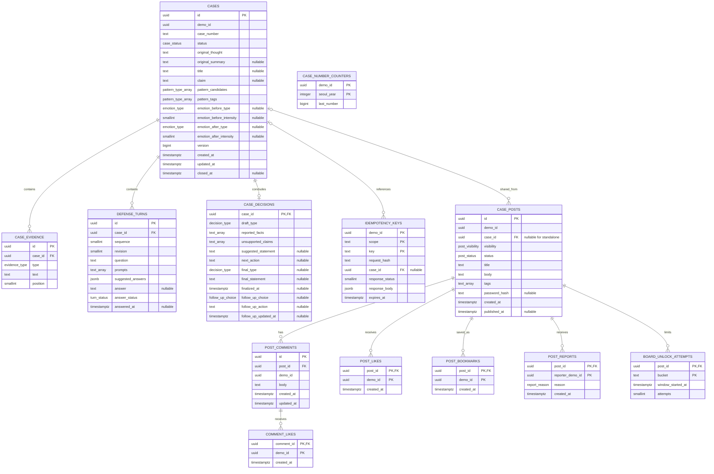

# 체포하겠어 · 전시용 v1.4 API 및 ERD

2026-11-18 기준. FastAPI가 `X-Demo-Id`로 체험을 구분하고 Supabase PostgreSQL의 `court_demo` 스키마에 저장한다. 회원가입·로그인·토큰 검증·회원 테이블은 사용하지 않는다. LangGraph와 Upstage Solar가 사건 진행의 AI 결과를 생성한다. 전체 경로·요청·응답은 [API 명세서](api-spec.md), 기계 판독 스키마는 [OpenAPI](openapi.json)를 따른다.

## API 구성

공통 경로는 `/api/v1`이고 모든 업무 요청에 `X-Demo-Id: <UUID v4>`를 보낸다. 접수만 `Idempotency-Key`가 추가로 필요하다. `GET /health/live`, `GET /health`는 공통 경로 밖에 있으며 체험 ID가 필요 없다.

| 기능 | 대표 API |
|---|---|
| 사건 접수·보관함 | `POST /cases`, `GET /cases`, `GET /cases/{id}`, `GET /cases/stats`, `DELETE /cases/{id}` |
| 기소·근거·변론 | `/cases/{id}/prosecution`, `/evidence`, `/defense/questions` 및 문항별 `/answer`, `/simplify` |
| 판결·감정·작은 행동 | `/cases/{id}/decision`, `/decision/rephrase`, `/decision/final`, `/follow-up/options`, `/follow-up` |
| 사건 공유·별도 글쓰기 | `POST /cases/{id}/posts`, `POST /board/posts` |
| 게시판·내 글·상세 | `GET /board/posts`, `GET /board/posts/mine`, `GET /board/posts/{post_id}` |
| 내 글 수정·삭제 | `PUT /board/posts/{post_id}`, `DELETE /board/posts/{post_id}` |
| 보호 글·신고 | `POST /board/posts/{post_id}/unlock`, `POST /board/posts/{post_id}/reports` |
| 댓글 | `GET`·`POST /board/posts/{post_id}/comments`, `PUT`·`DELETE /board/comments/{comment_id}` |
| 글·댓글 공감 | `PUT`·`DELETE /board/posts/{post_id}/like`, `PUT`·`DELETE /board/comments/{comment_id}/like` |
| 북마크 | `PUT`·`DELETE /board/posts/{post_id}/bookmark`, `GET /board/bookmarks` |

사건은 `received → evidence_review → defense → decision_review → closed`로 진행한다. 지원 안내 분기는 `support_required` 상태다. 게시글은 작성·수정 후 `pending_review`, 운영자 승인 후 `published`, 숨김 시 `hidden`이다. 댓글·공감·북마크는 승인된 공개 글에서만 사용한다.

## ERD

`demo_id`는 기기에서 만든 UUID이며 회원 테이블을 참조하지 않는다. 아래 모든 테이블은 `court_demo` 스키마에 속한다. 사건번호 카운터는 `(demo_id,seoul_year)`로 묶이며 FK를 요구하지 않는다.

## 자료형과 제약

| 데이터 | JSON | PostgreSQL | 조건 |
|---|---|---|---|
| 사건·질문·게시글·댓글 ID | UUID string | `uuid` | 서버 발급 기본키 |
| 체험 ID | UUID v4 string | `uuid` | API 헤더로 전달. 회원 FK 없음 |
| 사건번호 | string | `text` | `(demo_id,case_number)` 고유. 서울 기준 연도별 발급 |
| 사건 접수 요약 | string 또는 null | `text` | 1~40자. 기존 사건은 null 허용 |
| 원문·주장·게시글 본문 | string | `text` | API에서 공백 제거 후 1~2,000자 |
| 사건명·게시글 제목 | string | `text` | 1~120자 |
| 근거 | 객체 배열 | `case_evidence` | 사건당 최대 20개, 각 내용 1~2,000자 |
| 질문·답변·댓글 | string 또는 null | `text` | 각 1~1,000자. 댓글은 필수 문자열 |
| 질문 표현 내역 | string[] | `text[]` | 최초부터 최신 순서. 마지막 항목이 현재 질문 |
| 추천 답변 | `{rank,text}[]` | `jsonb` | 최신 질문의 추천 3개. 이전 기록은 빈 배열 가능 |
| 사고 패턴 | string[] | `pattern_type[]` | 11종. 후보 최대 2개, 확정 태그 중복 제거 |
| 감정 종류·강도 | `{type,intensity}` 또는 null | enum + `smallint` | 두 값을 함께 저장, 강도 0~100 |
| 질문 순번·revision | integer | `smallint` | 순번 1~3, revision 0~2 |
| 사건 버전 | integer | `bigint` | 0 이상, 충돌 확인에 사용 |
| 판결 문장·AI 다음 행동 | string 또는 null | `text` | 각 1~1,000자 |
| 사용자가 선택한 작은 행동 | string 또는 null | `text` | action일 때 1~500자, rest일 때 null |
| 게시글 태그 | string[] | `text[]` | API 최대 5개, 각 1~24자. DB는 배열 길이·null 원소 제한 |
| 보호 글 비밀번호 | string | 원문 저장 없음 | 요청에서만 8~64자. Argon2id 해시 저장 |
| 시각 | ISO 8601 string | `timestamptz` | API에서 UTC 시각 반환 |
| 공감·북마크 표시 | boolean | 관계 테이블에서 계산 | `liked_by_me`, `bookmarked_by_me` |
| 공감·댓글 수 | integer | 관계 테이블에서 집계 | 변경 가능한 카운터 열을 별도로 두지 않음 |
| 재시도 응답 | object | `jsonb` | 접수 응답 재사용에 필요한 데이터 |

공감·북마크는 대상 ID와 체험 ID의 복합 기본키로 중복을 막는다. 변론은 `(case_id,sequence)`가 고유하고 사건당 미응답 질문을 하나만 허용한다. 사건번호 카운터 증가는 사건 생성과 같은 트랜잭션에서 처리한다.

## 삭제와 공개 범위

- 사건 삭제는 근거·질문·판결·연결 게시글·접수 재시도 기록으로 전파된다. `case_id=NULL`인 별도 게시글은 남는다.
- 게시글 삭제는 댓글·글 공감·북마크·신고·잠금 해제 시도 기록으로 전파되고, 댓글 삭제는 댓글 공감으로 전파된다.
- `demo_id`는 소유권 확인에 사용하지만 응답에 포함하지 않는다. 게시글에는 원본 사건 ID도 노출하지 않는다.
- 승인된 공개 글만 공개 목록에 표시하고 댓글·공감·북마크를 허용한다. 보호 글은 승인 후 링크·비밀번호로 열람한다. 숨김이나 재검토 상태 전환은 하위 기록을 삭제하지 않는다.
- 글 수정 후 `status=pending_review`이며 최초 `published_at`은 유지한다. 댓글은 즉시 표시하고 별도의 댓글 승인 상태는 두지 않는다.

## DB 적용

신규 DB는 [schema-demo.sql](../db/schema-demo.sql)을 한 번 실행한다. v1.3 DB에는 [게시판 확장 마이그레이션](../db/migrations/20261118_community_features.sql)을 적용한다. 그보다 이전 버전은 [명세서의 마이그레이션 순서](api-spec.md#7-db-적용검증)를 따른다. 기존 글의 `demo_id`는 연결 사건에서 채우고 `case_id`의 필수 조건은 해제한다.

`court_demo`는 Supabase Data API에 노출하지 않는다. 스키마 소유자가 아닌 FastAPI 전용 DB 계정을 쓰면 새 네 테이블에도 `SELECT`, `INSERT`, `UPDATE`, `DELETE` 권한을 부여한다. `PUBLIC`, `anon`, `authenticated`의 접근 제한은 유지한다. 이전 회원 기반 `db/schema.sql`은 현재 전시용 DB 생성에 사용하지 않는다.
