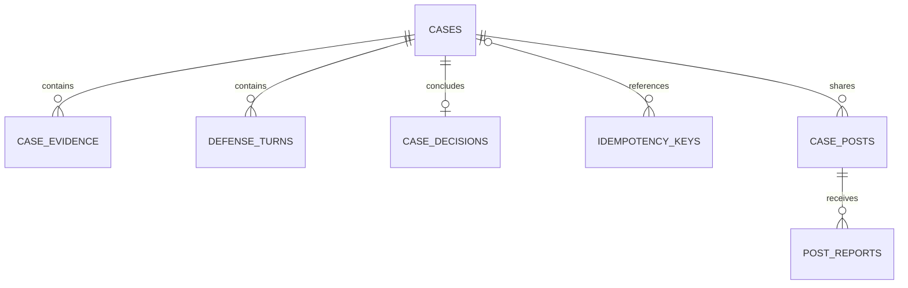

# 체포하겠어 · 전시용 모바일 앱 요구사항 명세서 v1.2

이 문서는 v1.2 기본 요구사항 기록이다. 최신 기능과 요청·응답은 댓글·공감·북마크·독립 글쓰기를 포함한 [전시용 API 명세서 v1.4](api-spec.md)을 참조한다.

[프론트 연동 계약과 실행 응답 예시](frontend-integration.md)에서 변론 추천 답변·질문 이력, 사건번호와 CORS 설정을 확인할 수 있다.

| 항목 | 내용 |
|---|---|
| 프로젝트 | 2026 간지톤 · 체포하겠어 |
| 서비스 | 생각에 대한 근거를 검토하고, 사용자가 받아들일 수 있는 문장으로 정리하는 모바일 앱 |
| 백엔드 | FastAPI · Render Web Service |
| 사용 방식 | 앱 실행 후 전시 체험 바로 시작 |
| 데이터 저장 | Supabase PostgreSQL |
| AI 흐름 | LangGraph · Upstage Solar · 기소 초안, 변론 질문, 판결 초안 생성 |
| API 기본 주소 | `https://<render-service>.onrender.com/api/v1` |

## 1. 서비스 범위

사용자가 괴로운 생각을 접수하면 AI가 사건의 쟁점과 근거를 정리한다. 사용자는 근거를 확인하고 변호인 질문에 답한 뒤, 판결 초안을 검토해 자신이 받아들일 수 있는 문장으로 사건을 마무리한다. 법정에서 심리하는 대상은 **사용자가 입력한 생각이나 주장**이다. 앱을 열면 회원가입과 로그인 없이 체험을 시작한다. 개인 정보 입력이 필요 없는 예시 사건을 첫 화면에서 제공한다.

**사건 접수 → 기소·증거 확인 → 변론 → 판결·최종 확정 → 사건파일 보관함**

| 구분 | 요구사항 |
|---|---|
| 핵심 기능 5개 | 사건 접수, 기소, 변론, 판결, 사건파일 보관함 |
| 핵심 흐름 보완 | 증거 확인·수정, 변론 도움 버튼, 휴정·이어하기, 판단 보류, 최종 진술문 직접 확정 |
| 후속 경험 | 판결 이후 작은 행동, 비슷한 사건 게시판, 선택해서 공유하는 사건 카드 |

기능 번호는 이 문서에서 새로 정리했다. 사용자가 제출한 확장 항목과 핵심 기능 표의 사건파일 보관함을 모두 포함한다.

## 2. 기능 요구사항

| ID | 기능 | 요구사항 |
|---|---|---|
| FR-01 | 사건 접수 | 생각을 한 줄 이상 입력하면 사건번호를 발급한다. 감정 종류와 강도(0~100)는 함께 선택하거나 함께 생략할 수 있다. 지원 안내가 필요한 입력은 법정 화면으로 넘기지 않는다. |
| FR-02 | 기소 | 검사 역할의 AI가 사건명, 검토할 주장, 사고 패턴 후보, 근거 초안을 만든다. 초안의 근거는 사용자가 입력한 내용에서 가져온다. |
| FR-03 | 변론 | 변호인 역할의 AI가 확인한 근거와 앞선 답변을 읽고 질문을 한 번에 하나씩 제시한다. 사건당 최대 3개이며, 답변에 따라 다음 질문을 조정한다. |
| FR-04 | 판결 | 판사 역할의 AI가 사용자가 보고한 사실, 근거가 부족한 해석, 수정된 생각을 정리한다. 종료 감정은 선택이며, 같은 감정을 접수와 종결에 기록한 경우 두 강도를 비교해 보여준다. |
| FR-05 | 사건파일 보관함 | 현재 기기에 저장된 체험 ID에 해당하는 사건을 날짜순으로 보고, 진행 상태나 확정한 사고 패턴으로 찾아 상세 내용을 다시 볼 수 있다. 보관함 통계는 종결된 사건만 집계한다. |
| FR-06 | 증거 확인·수정 | 직접 경험한 일, 전해 들은 말, 추측, 미확인 정보를 구분한다. 사용자는 내용과 유형을 수정하고, 근거를 추가·삭제하거나 사고 패턴 후보를 변경할 수 있다. 확정한 내용이 변론의 입력이 된다. |
| FR-07 | 변론 도움 버튼 | `떠오르지 않아요`는 답변 텍스트 없이 현재 질문을 마치고, 다음 질문을 요청하면 판단에 필요한 정보나 다른 관점을 묻는다. `질문을 쉽게 바꿔주세요`는 현재 질문의 표현만 바꾼다. `건너뛰기`는 현재 질문을 답변 없이 마친다. |
| FR-08 | 휴정·이어하기 | 진행 중인 사건에서 휴정할 수 있다. 저장된 상태와 현재 질문으로 복귀한다. 입력 중이지만 제출하지 않은 문장은 휴정 시 선택에 따라 기기의 보호된 임시 저장 공간에 보관한다. |
| FR-09 | 판단 보류 | 근거가 부족하면 확인한 내용과 아직 모르는 내용을 분리해 보여준다. 사용자는 `deferred`로 사건을 종결할 수 있다. |
| FR-10 | 최종 진술문 직접 확정 | 사용자는 판결 초안의 문장을 그대로 선택하거나 직접 수정할 수 있다. 확정 전에는 다른 표현을 요청할 수 있다. 서버는 AI 초안과 사용자가 확정한 문장을 구분해 저장한다. |
| FR-11 | 판결 이후 작은 행동 | 종결된 사건에서 AI가 제안한 행동을 선택하거나, 사용자가 직접 작은 행동 한 가지를 적을 수 있다. `오늘은 쉬기`도 선택할 수 있다. 저장한 행동은 사건파일 상세에 표시한다. |
| FR-12 | 비슷한 사건 게시판 | 현재 체험 ID로 종결한 사건에서 선택·편집한 내용을 전시 게시판에 공유한다. 공개 글은 상황 태그나 제목·본문 검색어로 탐색할 수 있다. 사고 패턴을 공유하고 싶으면 게시글 태그에 직접 추가할 수 있다. 비밀번호 보호 글은 공유 링크와 게시글 비밀번호로 조회한다. |
| FR-13 | 선택해서 공유하는 사건 카드 | 종결된 사건에서 선택한 문장과 직접 작성한 도움 요청을 카드로 미리 본다. 사용자가 확인한 내용을 PNG로 기기에 저장하거나 운영체제 공유 메뉴로 전달한다. |

사고 패턴 후보는 흑백논리(`all_or_nothing`), 과잉일반화(`overgeneralization`), 독심술(`mind_reading`), 파국화(`catastrophizing`), 낙인찍기(`labeling`), 긍정 격하(`discounting_positives`)다. 사용자는 태그를 0개 이상 확정할 수 있다. 근거 유형은 `observed`, `reported`, `interpretation`, `unknown`이다.

### 2.1 사건 흐름과 저장

`received → evidence_review → defense → decision_review → closed`

- `received`에서 기소 초안을 생성하면 `evidence_review`로 이동한다. 근거를 확정하면 `defense`로 이동한다.
- 변론 질문을 하나 이상 처리하고 미응답 질문이 없으면 판결 초안을 요청할 수 있다. 답변하기, 떠오르지 않음, 건너뛰기 모두 질문 처리에 해당한다.
- 판결 초안이 생성되면 `decision_review`로 이동한다. 사용자가 결과를 확정하면 종결 시각과 함께 `closed`로 저장한다.
- 휴정 중에도 서버의 사건 상태를 유지한다. 재접속 시 사건 상세의 `status`, `version`, 미응답 질문을 기준으로 복원한다. 기기 임시 저장본은 같은 체험 ID와 입력 단계에서만 보여준다. 접수 후에는 사건 ID까지 일치해야 한다. 사건 삭제, 입력 제출, 앱 데이터 초기화 시 해당 임시 저장본을 지운다.
- 사건 진행 중 지원 안내가 필요하면 `support_required`로 전환한다. 최초 접수에서 전환되는 경우에는 사건을 만들지 않는다. 종결 이후의 행동 입력 또는 게시글 작성 중에는 해당 요청만 중단하고 종결 기록을 보존한다.

### 2.2 게시판 공개 범위

| 공개 범위 | 조회 조건 | 게시판 목록·검색 |
|---|---|---|
| `public` · 전시 공개 | 전시 앱 방문자. 게시 전 검토를 통과한 글만 조회 | 포함 |
| `password_protected` · 비밀번호 보호 | 글 ID를 담은 링크와 게시글 비밀번호를 가진 방문자. 게시 전 검토를 통과한 글만 조회 | 제외 |

- 게시하기 직전에 실제 공개될 제목, 본문, 선택한 태그를 미리 보여준다. 앱은 사용자가 선택한 텍스트만 전송하고, 사용자가 이름·회사명 등 식별 정보를 지울 수 있게 한다.
- 게시글은 별도 레코드에 공유 시점의 제목과 본문을 저장한다. 게시글을 통해 원본 사건에 접근할 수 있는 권한을 부여하지 않는다. 일반 조회 응답에는 게시글 ID, 공개 제목·본문, 선택한 태그, 게시 시각만 포함한다.
- 비밀번호는 8~64자로 받고 요청 본문으로 전달한다. 서버에는 Argon2id 해시를 저장하고, 비밀번호 검증 요청의 횟수를 제한한다. 공유 URL, 일반 운영 로그, 응답에는 비밀번호와 해시를 담지 않는다. [OWASP 비밀번호 저장 지침](https://cheatsheetseries.owasp.org/cheatsheets/Password_Storage_Cheat_Sheet.html)
- 비밀번호 보호 글은 링크의 글 ID로 `POST /board/posts/{post_id}/unlock`을 호출하고, 비밀번호가 일치하면 해당 요청에 게시글 본문을 반환한다. 없는 글, 조회할 수 없는 글, 틀린 비밀번호는 모두 동일한 `404` 응답을 사용한다. 응답에는 `Cache-Control: no-store`를 적용한다.
- 작성자는 내 게시글 목록에서 검토 상태를 확인하고 게시글을 삭제할 수 있다. 원본 사건을 삭제하면 해당 사건에서 만든 게시글도 삭제된다.
- 제출된 게시글은 `pending_review`로 시작한다. 운영 검토에서 승인하면 `published`로 바꾸며, 신고를 검토해 필요하면 `hidden`으로 전환한다. `pending_review`와 `hidden`의 상세는 글을 올린 체험 ID로 조회한다. 운영자는 Supabase 관리 화면에서 검토 상태를 바꾼다. 신고자 체험 ID는 앱 방문자에게 공개하지 않는다. 최초 승인 시 `published_at`을 기록하고, 숨김 처리 후에는 기존 링크로도 다른 방문자가 열 수 없다.

### 2.3 사건 카드 내보내기

모바일 앱은 본인 사건 상세에 이미 포함된 문장 중 사용자가 고른 항목과 추가 메시지를 조합한다. 예를 들어 최종 진술문과 “조언보다 잠깐 들어줬으면 좋겠어”를 선택해 저장할 수 있다. 사건번호·원문·근거·감정 수치는 카드에 기본 포함하지 않는다. 미리보기에서 공개 내용을 확인한 뒤 앱에서 PNG를 생성한다. 게시판 게시 동작과는 별개이며, 카드 이미지 저장 및 외부 전송에 별도 API나 서버 저장소가 필요하지 않다.

## 3. API 계약

`/health`, `/health/live` 외의 경로는 모두 `/api/v1`을 앞에 붙인다. 모바일 앱은 JSON과 HTTPS를 사용한다. 사건 ID는 UUID, 화면 표시용 사건번호는 체험 ID와 서울 기준 연도별로 001부터 발급하는 서버 생성 문자열, 시간은 UTC ISO 8601이다.

- 앱은 최초 실행 시 랜덤 UUID v4를 한 번 생성해 기기에 저장한다. 모든 `/api/v1` 요청에 `X-Demo-Id` 헤더로 같은 값을 보낸다. 앱 데이터를 초기화하면 새 체험 ID로 시작한다.
- 서버는 `X-Demo-Id`의 UUID v4 형식을 확인한 뒤 사건과 내 게시글을 분류하는 키로 사용한다. 사용자 등록, 로그인, 액세스 토큰 발급·검증은 전시 흐름에서 제외한다. 체험 ID는 일반 API 응답이나 공유 URL에 포함하지 않는다.
- 같은 전시 기기를 여러 사람이 번갈아 쓰는 경우 새 방문자 체험을 시작할 때 앱의 체험 ID를 갱신한다. 이전 체험의 임시 입력을 지우고 새 보관함을 연다.

| 구분 | 메서드·경로 | 입력 및 반환 |
|---|---|---|
| 기존 | `POST /cases` | `thought`, `emotion?`, `Idempotency-Key` 헤더. `201` 사건 또는 `200` 지원 안내 |
| 기존 | `POST /cases/{case_id}/prosecution` | `200` 사건명·주장·태그 후보·근거 초안. 재시도 시 저장된 초안 |
| 기존 | `PUT /cases/{case_id}/evidence` | `claim`, `pattern_tags[]`, `evidence[{type,text}]`. `200` 확정 결과 및 변론 상태 |
| 기존 | `POST /cases/{case_id}/defense/questions` | `201` 새 질문 또는 `200` 미응답 질문. `id`, `sequence`, `prompt`, `revision`, `prompts[]`, `suggested_answers[{rank,text}]` 반환 |
| 변경 | `PUT /cases/{case_id}/defense/questions/{question_id}/answer` | `action=answer\|skip\|not_sure`, `text?`, `revision`. `200` 처리 결과 |
| 추가 | `POST /cases/{case_id}/defense/questions/{question_id}/simplify` | `revision`. `200` 같은 질문의 새 표현과 증가한 `revision` |
| 기존 | `POST /cases/{case_id}/decision` | `200` 판결 초안. 재시도 시 현재 저장된 초안 |
| 추가 | `POST /cases/{case_id}/decision/rephrase` | `style=neutral\|shorter\|gentler`, `version`. `200` 재표현된 제안 문장 및 새 버전 |
| 기존 | `PUT /cases/{case_id}/decision/final` | `decision_type`, `final_statement?`, `emotion_after?`. `200` 종결된 사건 |
| 추가 | `PUT /cases/{case_id}/follow-up` | `choice=action\|rest`, `action_text?`. `200` 저장된 행동 또는 휴식 선택 |
| 변경 | `GET /cases` | `status?`, `pattern?`, `limit?`, `cursor?`. `200` 내 사건 목록과 다음 커서 |
| 변경 | `GET /cases/{case_id}` | `200` 사건·근거·질문·판결·작은 행동. `status`, `version`으로 이어하기 지원 |
| 기존 | `GET /cases/stats` | `from`, `to`, `timezone`. `200` `closed_count`, `pattern_counts`, `emotion_change` |
| 기존 | `DELETE /cases/{case_id}` | `204` 현재 체험 ID의 사건과 종속 데이터 삭제 |
| 추가 | `POST /cases/{case_id}/posts` | `visibility`, `title`, `body`, `tags?`, `password?`. `201` 글 ID 및 검토 상태 |
| 추가 | `GET /board/posts` | `tag?`, `q?`, `limit?`, `cursor?`. `200` 게시된 공개 글 목록과 다음 커서 |
| 추가 | `GET /board/posts/mine` | `limit?`, `cursor?`. `200` 내 게시글 ID·제목·공개 범위·검토 상태 및 다음 커서 |
| 추가 | `GET /board/posts/{post_id}` | `200` 공개 글 본문. 작성에 사용한 체험 ID로 요청하면 보호·검토 중·숨김 글도 조회 |
| 추가 | `POST /board/posts/{post_id}/unlock` | `password`. `200` 검증한 보호 글 본문 또는 `404` |
| 추가 | `POST /board/posts/{post_id}/reports` | `reason`. 게시된 공개 글에 신고 등록. `201` 또는 기존 신고 `200` |
| 추가 | `DELETE /board/posts/{post_id}` | `204` 현재 체험 ID로 올린 게시글 삭제 |
| 기존 | `GET /health/live`, `GET /health` | 체험 ID 생략. 서버 실행 확인 및 DB 연결 상태 확인 |

### 3.1 입력과 응답 세부 규칙

- 생각·주장·근거는 앞뒤 공백 제거 후 1~2,000자, 사건명은 1~120자다. 한 사건의 근거는 최대 20개다. 질문, 답변, 최종 진술문은 1~1,000자다. 감정은 `{ "type": "anxiety", "intensity": 80 }` 형식이다. 유형은 `anxiety`, `sadness`, `anger`, `shame`, `guilt`, `other` 중 하나다. 강도는 0~100 정수다.
- 사건 접수에서 같은 체험 ID·키로 같은 본문을 다시 보내면 기존 응답을 반환한다. 같은 키로 다른 본문을 보내면 `409`를 반환한다.
- 변론의 `text`는 `answer`에만 필요하다. `not_sure`와 `skip`은 텍스트 없이 저장한다. 질문을 쉽게 바꿀 수 있는 대상은 미응답 질문이다. 질문 ID와 순번을 유지하고 `revision`을 증가시키며, 표현을 `prompts`에 추가하고 최신 추천 답변을 갱신한다. 기존 순번에서 최대 두 번 바꿀 수 있다. 이전 버전으로 보낸 답변에는 `409`를 반환한다.
- 판결 유형은 `reframed`, `deferred`, `action_needed`다. 판결 초안은 `type`, `reported_facts[]`, `unsupported_claims[]`, `suggested_statement`, `next_action`을 반환한다. 확정할 `decision_type`은 필수이며, `final_statement`는 `deferred`일 때만 생략할 수 있다. 재표현은 `decision_review`에서 제안 문장만 갱신한다.
- 작은 행동은 `closed` 사건에만 저장한다. `choice=action`이면 `action_text`는 1~500자 필수다. `choice=rest`면 생략한다. 수정 시 기존 선택을 교체한다.
- 게시글 제목은 1~120자, 본문은 1~2,000자다. `tags`는 최대 5개, 개당 1~24자다. `q`는 1~100자이며 공개 제목·본문을 검색한다. `public`은 비밀번호를 받지 않고, `password_protected`는 비밀번호가 필수다.
- 신고 사유는 `personal_information`, `harmful_content`, `other` 중 하나다. 한 체험 ID는 동일 게시글에 한 건만 신고할 수 있다.
- 목록 기본 크기는 20, 최대 50이다. 사건은 `created_at DESC, id DESC`, 공개 게시글은 `published_at DESC, id DESC`로 정렬한다. 내 게시글은 `created_at DESC, id DESC`로 정렬한다.
- 통계는 지정한 시간대의 종결일을 기준으로 시작일을 포함하고 종료일을 제외한다. 감정 변화는 같은 감정을 전후 모두 기록한 경우의 `종료 강도 - 접수 강도` 평균과 건수를 반환한다. 집계 대상이 없으면 평균은 `null`이다.
- `/cases/stats`와 `/board/posts/mine`은 각 ID 경로보다 먼저 등록한다.

판결 이후 행동 저장 예시

```json
{
  "choice": "action",
  "action_text": "내일 발표 자료에서 보완할 부분 한 가지만 확인하기."
}
```

게시글 등록 예시

```json
{
  "visibility": "public",
  "title": "회의 발표가 마음에 걸린 날",
  "body": "한 번 말이 꼬였다는 이유로 내 업무 능력 전체를 판단할 수는 없다.",
  "tags": ["발표", "직장"]
}
```

### 3.2 오류 및 지원 안내

| 상태 | 처리 |
|---|---|
| `404` | 리소스가 없거나 현재 체험 ID 또는 게시글 조회 조건과 일치하지 않음 |
| `409` | 현재 단계에서 허용하지 않는 요청, 중복 키 불일치, 질문 또는 사건 버전 충돌 |
| `422` | 체험 ID 누락·형식 오류 또는 입력 길이·범위 위반 |
| `429` | 요청 또는 비밀번호 검증 횟수 제한 |
| `502` | AI 응답 형식 검증 실패 |
| `503` | AI 또는 DB의 일시적 장애 |

오류 응답은 `{ "error": { "code": "...", "message": "...", "request_id": "..." } }` 형식을 사용한다. 입력이 지원 안내로 전환되면 `200`과 `outcome: "support_required"`, 안내 문구 및 상담 연락처를 반환한다. 앱은 법정 흐름을 멈추고 지원 안내 화면을 표시한다. 안내로 전환한 입력은 원문을 사건이나 게시글, 운영 로그에 남기지 않는다. 한국 사용자용 확인 연락처는 자살예방상담전화 [109](tel:+82109?oai_link_source=model_response_hotline)이며, 추가 기관 정보는 운영팀이 확인한 뒤 서버 설정에 등록한다.

## 4. PostgreSQL 및 ERD 변경



| 테이블 | 기존 데이터 및 변경 사항 |
|---|---|
| `cases` | `id uuid` PK, `demo_id uuid NOT NULL`, `case_number text` 고유. 원문·제목·주장 `text`, 상태 및 감정 유형 `enum`, 감정 강도 `smallint`, 패턴 후보·태그 `enum[]`, `version bigint`, 생성·수정·종결 시각 `timestamptz`. 휴정은 기존 상태로 처리한다. |
| `case_evidence` | `id uuid` PK, `case_id uuid` FK, `type enum`, `text text`, `position smallint`. 사건별 순서 고유. |
| `defense_turns` | `id uuid` PK, `case_id uuid` FK, `sequence smallint`, `question text`, `answer text NULL`, `answer_status enum`, `answered_at timestamptz NULL`. 상태에 `not_sure`를 추가하고 `revision smallint NOT NULL DEFAULT 0`을 추가한다. 사건당 미응답 질문 최대 1개, 질문 순번 1~3, revision 0~2. |
| `case_decisions` | `case_id uuid` PK/FK, 초안·확정 유형 `enum`, 근거·해석 목록 `text[]`, 제안·확정 문장 및 AI의 `next_action` 제안 `text`. 사용자 선택은 `follow_up_choice enum NULL`, `follow_up_action text NULL`, `follow_up_updated_at timestamptz NULL`에 별도로 저장한다. |
| `idempotency_keys` | `(demo_id uuid, scope text, key text)` 복합 PK, 요청 해시 `text`, 사건 참조 `uuid NULL`, 응답 상태 `smallint`, 응답 `jsonb`, 만료 시각 `timestamptz`. |
| `case_posts` | `id uuid` PK, `case_id uuid` FK, `visibility enum`, `status enum`, `title text`, `body text`, `tags text[]`, `password_hash text NULL`, `created_at timestamptz`, `published_at timestamptz NULL`. 작성한 체험 ID는 연결된 사건의 `demo_id`로 확인한다. |
| `post_reports` | `post_id uuid` FK, `reporter_demo_id uuid NOT NULL`, `reason enum`, `created_at timestamptz`. `(post_id, reporter_demo_id)` 복합 PK. |

- `answer_status=answered`인 경우에만 답변 텍스트를 저장한다. `pending`은 처리 시각이 비어 있고, `answered`·`skipped`·`not_sure`는 처리 시각을 저장한다.
- `follow_up_choice`는 `action`, `rest` 또는 `NULL`(미선택)이다. 행동 텍스트는 `action`에서만 필수다.
- 게시글의 `visibility`와 `status`는 각각 `public\|password_protected`, `pending_review\|published\|hidden`이다. DB 제약으로 비밀번호 보호 글에만 해시를 요구한다. 공개 목록에 `visibility='public' AND status='published'` 조건을 적용한다.
- 사건 삭제 시 근거·질문·판결·재시도 기록·게시글은 함께 삭제된다. 게시글을 삭제하면 관련 신고도 함께 삭제된다. 신고자 체험 ID와 게시글 해시는 일반 조회 응답에서 제외한다.
- 전시 테이블은 `court_demo` 스키마에 둔다. `case_posts(case_id)`와 공개 피드용 `(published_at DESC, id DESC)` 부분 인덱스를 추가한다. 서버는 사건의 `demo_id`와 게시글 열람 조건을 각각 확인한다. 사건 목록과 통계 인덱스는 `(demo_id, created_at DESC, id DESC)`, `(demo_id, closed_at)`를 사용한다. 체험 ID는 각 테이블에 직접 기록하며 회원 테이블에 대한 외래 키는 두지 않는다.

## 5. 구현·운영 요구사항

- Render에서 FastAPI를 실행하고 Supabase PostgreSQL에 연결한다. 서버 환경변수에 `DATABASE_URL`과 Upstage 설정(`AI_PROVIDER=upstage`, `AI_MODEL`, `UPSTAGE_API_KEY`)을 둔다. 모바일 앱은 API 기본 주소와 기기에서 만든 체험 ID를 사용한다. 운영자의 게시글 승인·숨김은 Supabase 관리 화면에서 처리한다.
- LangGraph는 요청 단위로 실행한다. 기소, 변론 질문, 질문 재표현, 판결, 판결 문장 재표현을 분리하고 Pydantic으로 응답 형식을 확인한다. 판결 초안 생성 실패 시 기존 기록과 진행 단계가 유지된다.
- AI 호출은 DB 트랜잭션 밖에서 수행한다. 저장 직전 상태·버전을 확인하고, 상태 변경과 관련 기록 저장은 하나의 트랜잭션으로 처리한다.
- 게시판과 카드에 필요한 텍스트는 사용자가 선택한 범위로 제한한다. API는 사용자 원문·답변·게시글 비밀번호·체험 ID를 일반 운영 로그에 기록하지 않는다.
- 전시용 FastAPI는 `court_demo`에 연결한다. `db/schema-demo.sql`을 적용해 전시 테이블을 생성한다. 기존 회원 기반 `db/schema.sql`은 이전 버전 참고용이다.

## 6. 인수 기준

1. 회원가입과 로그인 화면을 거치지 않고 생각 접수부터 보관함까지 핵심 5개 흐름이 동작한다. 감정을 생략해도 사건을 종결할 수 있다.
2. 증거에서 추측을 수정하면 이후 변론 질문과 판결에 수정한 값이 반영된다.
3. `떠오르지 않아요`와 `건너뛰기`를 눌러 다음 질문이나 판결로 진행할 수 있다. 질문을 쉽게 바꿔도 순번과 전체 질문 개수는 증가하지 않는다.
4. 휴정 후 기존 진행 단계와 미응답 질문을 불러올 수 있고, 선택해 보관한 미제출 입력을 같은 기기에서 복원할 수 있다.
5. 판단 보류로 종결할 수 있으며, 사용자가 수정·확정한 문장과 AI의 초안이 구분되어 저장된다.
6. 판결 이후 행동 또는 휴식을 선택할 수 있고, 사건 상세를 다시 열면 선택이 유지된다.
7. 공개 글은 게시 승인 이후 게시판에서 찾을 수 있다. 보호 글은 목록과 검색에서 제외되며, 수신자가 링크와 올바른 비밀번호로 조회할 수 있다.
8. 게시글 응답에 연결된 사건 원문은 포함되지 않는다. 서로 다른 체험 ID의 보관함에는 각 체험에서 만든 사건만 표시된다. 글을 삭제하거나 원본 사건을 삭제하면 게시판과 공유 링크에서 해당 글을 열 수 없다.
9. 카드에 선택한 내용만 표시된다. 미리보기에서 확인한 뒤 PNG 저장과 앱의 공유 메뉴를 사용할 수 있다.
10. 중복 접수, 다른 체험 ID의 사건 접근, 지원 안내 전환, AI 장애에서 정해진 응답과 상태 보존 규칙이 동작한다.
